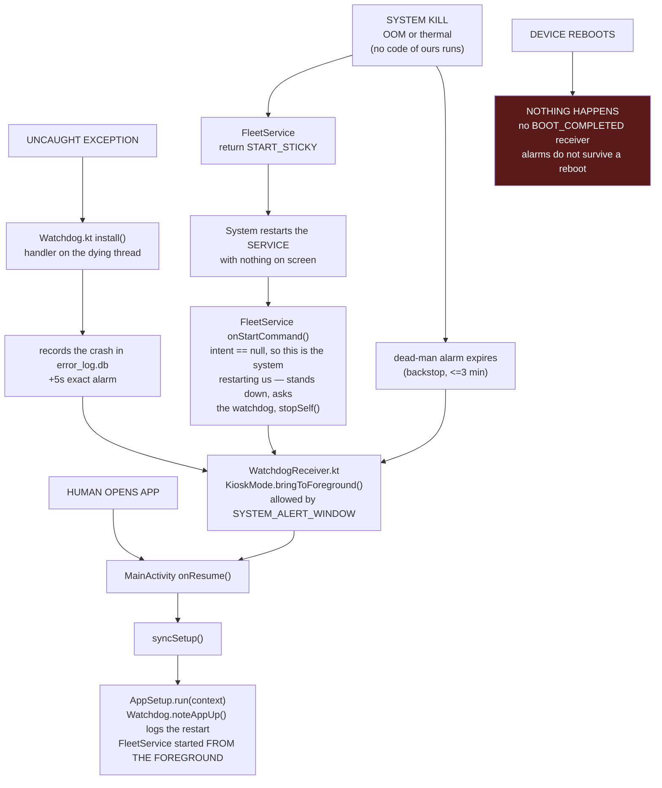
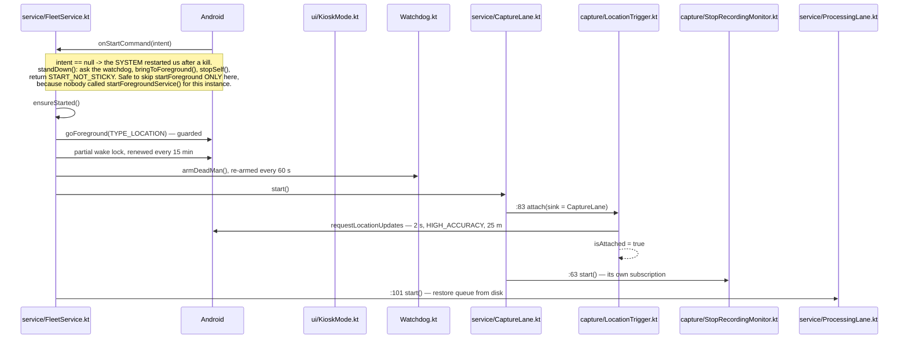
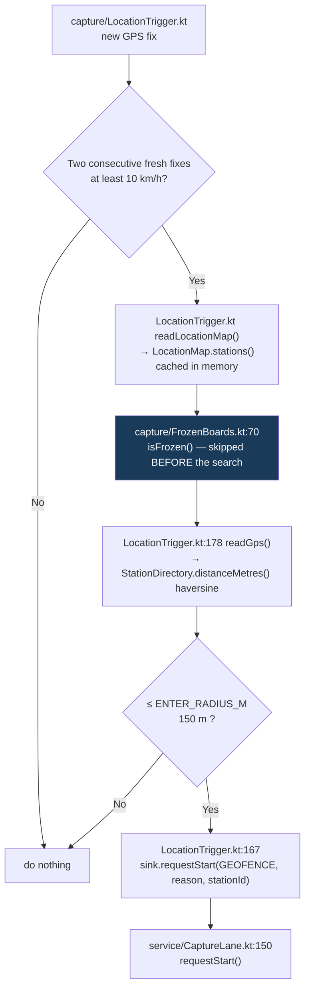
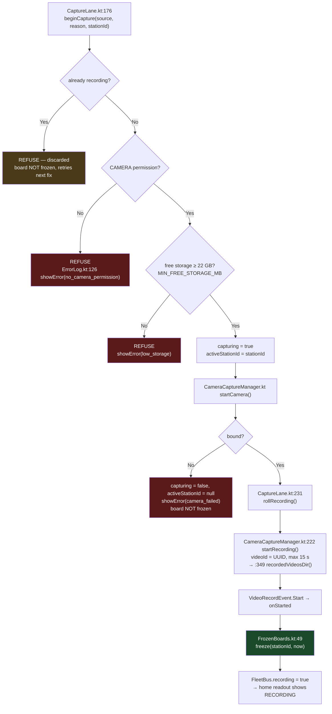

# Stage 0 — from app start to video on disk

Every box names the **file and line** that does the work. Stage 0 ends when a clip is written to
`filesDir/recorded_videos/<video_id>.mp4` and queued; everything after that is Stage 1.

All paths are relative to `app/src/main/java/com/terminalscout/app/prod/`.

---

## 0. File map — what each part is

| File | Role in Stage 0 |
|---|---|
| `App.kt` | the first code in the process; opens the error log, installs the crash handler |
| `MainActivity.kt` | the screen; runs setup, owns kiosk and exit |
| `AppSetup.kt` | the setup stage — permissions, tables, schedulers, service start |
| `Watchdog.kt` | brings the app back after a crash or a system kill |
| `WatchdogReceiver.kt` | what the alarm wakes; raises the Activity, then checks Stage 0 |
| `Stage0Health.kt` | is the device actually capable of recording right now |
| `service/FleetService.kt` | the foreground service; owns both lanes and the FGS types |
| `service/CaptureLane.kt` | owns the camera; turns a request into a clip |
| `service/ProcessingLane.kt` | owns the queue; hands clips to Stage 1 |
| `capture/LocationTrigger.kt` | the always-on GPS ↔ station comparison |
| `capture/StopRecordingMonitor.kt` | watches frozen boards; ends recordings |
| `capture/FrozenBoards.kt` | which boards must not be captured again yet |
| `capture/LocationMap.kt` | the station table (`location_map.db`) |
| `CameraCaptureManager.kt` | CameraX; writes the `.mp4` |
| `VideoQueueStore.kt` | durable queue on disk |
| `ui/KioskMode.kt` | keeps the app on screen |
| `ui/ErrorLog.kt` | the persistent error table (`error_log.db`) |

---

## 1. The four ways the app can start

Every arrow that is not a human ends in the **same place**: `MainActivity` on screen, and setup starting
the service *from the foreground*. That is not tidiness — it is the only order the platform allows. A
foreground service declaring `camera` or `location` cannot be created from the background, so a recovery
path that restarts the service directly produces a service that is alive and blind.



**Not covered, and not coverable:** a **force-stop** from Settings. It cancels the app's alarms and keeps
its receivers disabled until a human launches it. Only a second app or a device-owner DPC can undo that.

**The off switch:** every watchdog path checks `KioskMode.isEnabled`. The kiosk switch already promises
"the app will not reopen itself", and it now means it. `EXIT DEVICE` calls `Watchdog.disarm` outright.

**The loop guard:** ten restarts inside a rolling ten minutes and the watchdog stands down with a row on
the errors screen. Ten minutes of not crashing resets the chain, so it caps a loop rather than a lifetime.

**A live process is not a working one.** The watchdog answers "is the process alive"; `Stage0Health`
answers "can it still record". The two run in different places and neither covers the other's case:

| the service is | who notices | how long |
|---|---|---|
| **gone** | the dead-man alarm — nothing is renewing it, so it finally fires | 3–5 min (inexact alarm window) |
| **up, but a lane inside it is dead** | the service's own 60 s renewal loop, which health-checks itself | ≤ 60 s |

That split is forced: the service renews the dead-man every 60 s against a 3-minute deadline, so while
the service lives the alarm can never fire. Measured on the bench — service stopped at 18:09:50, repaired
unattended at 18:14:12, and the three error rows it raised cleared themselves in the same second.

---

## 2. Setup — runs on every launch, idempotent

```mermaid
sequenceDiagram
    participant UI as MainActivity.kt
    participant SU as AppSetup.kt
    participant EL as ui/ErrorLog.kt
    participant WD as Watchdog.kt
    participant WM as WorkManager
    participant SVC as service/FleetService.kt

    UI->>SU: syncSetup() → run(context)
    SU->>EL: ErrorLog.init() — opens error_log.db
    Note over SU: Every step below is wrapped. A failure becomes a row on the<br/>errors screen and the pass CONTINUES; nothing here may throw,<br/>because run() is called from onResume and an escape crash-loops.
    SU->>WD: Watchdog.noteAppUp() — logs a restart, re-arms the dead-man
    SU->>SU: wipeOnFreshInstall() — clears working dirs ONLY if versionCode changed
    SU->>SU: ensureDirectories() — creates every missing folder under filesDir
    SU->>SU: ensureTables() — sqlite_master check per database, helper creates what is missing
    SU->>SU: UserStore.exists() — fails CLOSED, so an unreadable user.db holds the service
    SU->>SU: permissions + battery / overlay / exact alarms / GPS / kiosk
    SU->>WM: armBackgroundWork() — 4 periodic jobs, re-armed every pass
    SU->>SU: ensureStationMap() — request fetch if table empty
    SU->>SU: ensureModels() — start the download if a detection model is missing

    alt already running
        SU-->>UI: nothing to do
    else device info entered AND location granted
        SU->>SVC: FleetService.start(context) — from a VISIBLE activity
    else no device info
        SU-->>UI: service HELD — no device identity to stamp on a reading
    else location not granted
        SU-->>UI: service HELD — a location-type FGS without the grant throws
    end

    SU->>SU: backgroundServices() → n/5, counting a service THIS pass started
    SU->>EL: report() — raise/clear each condition, both directions
    SU-->>UI: Status
    UI->>UI: promptNextGap() — one permission prompt per launch
```

---

## 3. Service startup — what comes up



---

## 4. Steady state — the trigger loop, every 2 seconds



**Frozen boards are skipped before the nearest search**, not after. Filtering afterwards would let a frozen
station sitting closest hide the one behind it.

GPS-reported speed is used when available; otherwise speed is derived from consecutive positions
and elapsed times, allowing for reported location uncertainty. The speed gate applies only to
automatic capture requests, not manual captures.

---

## 5. Capture — every refusal, in order



**The freeze is last on purpose.** Every failure above leaves the board unfrozen, so the station is still
capturable on this visit. Only a recorder that is genuinely rolling takes it out of play.

---

## 6. Stopping, and the end of Stage 0

```mermaid
sequenceDiagram
    participant SM as capture/StopRecordingMonitor.kt
    participant FB as capture/FrozenBoards.kt
    participant CL as service/CaptureLane.kt
    participant CAM as CameraCaptureManager.kt
    participant FS as Disk
    participant LM as capture/LocationMap.kt
    participant PL as service/ProcessingLane.kt
    participant VQ as VideoQueueStore.kt

    loop every GPS fix
        SM->>SM: :97 onFix() — distance to each frozen board
    end
    SM->>CL: requestStop(reason, stationId) after 50 m travel from closest approach and sustained recession
    CL->>CL: ignored unless stationId == activeStationId
    CL->>CAM: :301 stopRecording()
    SM->>FB: unfreeze(id) separately when > 200 m
    CAM->>CAM: :278 resultOf() — Finalize → Result&lt;File&gt;
    CAM-->>CL: :261 finishCapture(result)

    alt success
        CL->>FS: clip already at<br/>filesDir/recorded_videos/&lt;uuid&gt;.mp4
        CL->>LM: :232 markCaptured(stationId, now)
        CL->>PL: :138 enqueueCapture(file, trigger)
        PL->>VQ: :47 add() → filesDir/video_queue/*.json
        Note over PL,VQ: ◀ END OF STAGE 0
    else failure
        CL->>CL: log + FleetBus; board STAYS frozen
    end

    CL->>CAM: release() unless a screen is watching
```

**Two ways a recording ends** — the monitor asks after 50 m of GPS path travel from the closest
observed approach to the station, with three increasing station-distance fixes spanning at least
10 m, or CameraX hits the 15 s cap (shorter if configured). The 200 m boundary only releases the station for a later
visit. Both recording endings arrive through the same `finishCapture` callback.

---

## 7. Failure matrix

| What happens | Service | Recovers on its own? | Code |
|---|---|---|---|
| Screen off / backgrounded | runs | ✅ FGS + wake lock | `FleetService.kt:184` |
| Swiped from recents | runs | ✅ no `onTaskRemoved` | — |
| Home pressed, kiosk ON | runs | ✅ relaunch | `MainActivity.kt:191` → `KioskMode.kt:99` |
| **Uncaught exception** | restarted | ✅ +5 s, app raised then service | `Watchdog.kt`, `WatchdogReceiver.kt` |
| Memory / thermal kill | restarted | ✅ `START_STICKY` stands down and asks for the app; dead-man alarm backs it up within 3 min | `FleetService.ensureStarted()`, `Watchdog.armDeadMan` |
| **Reboot** | dead | ❌ **nothing starts it** — alarms do not survive a reboot either | no receiver |
| User force-stop | dead | ❌ alarms cancelled, receivers disabled | — |
| Battery manager kill | dead | ⚠️ mitigated by exemption | `AppSetup.kt:208`+ |
| `EXIT DEVICE` | dead | ❌ deliberate | `MainActivity.kt:276` |

---

## 8. Two bugs this diagram exposed

### 8.1 A background restart is unguarded — FIXED

`location` is a while-in-use permission. On Android 14+ a background-started service is refused it, and
`startForeground` threw out of `onStartCommand` — so a `START_STICKY` restart on the Pixel crashed rather
than ran, and the crash was the app's own recovery attempt killing it again.

`FleetService.onStartCommand` now stands down when **`intent == null`**, which is precisely how
`START_STICKY` re-creates a service: with no intent. It asks the watchdog for the app, calls `stopSelf()`
and returns `START_NOT_STICKY`, so the system does not repeat the attempt. The next start comes from
`MainActivity`, in the foreground, where both types are available. `goForeground` is additionally
wrapped, so an Android 14+ refusal stands down instead of dying unexplained.

**The first attempt at this was wrong, and the device proved it.** It stood down on
`!KioskMode.isActivityVisible`, which is a race rather than a signal: the flag goes false the moment the
Activity pauses, so an explicit `startForegroundService()` from a visible Activity whose `onStartCommand`
landed just after that pause would stand down **without ever calling `startForeground`** — and that call
carries a five-second obligation. The platform killed the process with
`ForegroundServiceDidNotStartInTimeException`, the watchdog respawned it into the same race, and the unit
crash-looped until the ten-attempt guard stood the watchdog down. Caught by `adb shell am crash` on the
Nord; the null-intent test has no such race because nothing called `startForegroundService()` on that
path.

That relaunch is deliberately **not** charged to the crash-loop budget — the death that caused it has
already been counted, and paying twice for one fault would halve the guard.

**Related, fixed in the same pass:** `AppSetup.run` started the service as soon as device details existed,
without checking that location was granted. On a fresh install that is a `SecurityException` out of
`startForeground` before the permission dialog has even been answered. It now holds the service until
either grant is in hand, which is what makes the stated order — *check the permissions, then start the
background services* — true in code rather than only in the comment.

### 8.2 The autonomous path never claimed the camera type — FIXED

```
BEFORE
FleetService.fireCaptureStart()  →  promoteToCameraType()
        ↑ reached ONLY from the debug button and the adb intent

LocationTrigger  →  sink.requestStart(...)  →  CaptureLane.beginCapture()
        ↑ straight to the lane, bypassing FleetService entirely — never promoted
```

An **automatic** capture opened the camera while the service held only the `location` type. Harmless on
Android 12, which does not enforce it; on 14+ it is exactly the violation the FGS type system exists to
catch — so autonomous capture, the whole point of the unit, was the one path that never promoted.

The promotion moved **into the lane**, which is the one place every capture passes through whatever
trigger asked:

```
AFTER
LocationTrigger / ManualTrigger / adb  →  CaptureLane.beginCapture()
        →  onCameraNeeded()  →  FleetService.promoteToCameraType()
        →  only then bind the camera
```

`fireCaptureStart` no longer promotes at all, so the two paths that used to be special are not special
any more. It is called after the cheap refusals — there is no point promoting for a capture that was
never going to roll — and a refusal now aborts the capture rather than rolling a camera that will
produce a black clip. The board is not frozen at that point, so the trigger simply asks again on the
next fix, by which time the app has been brought forward and the retry can succeed.

The success path also logs now (`camera foreground-service type HELD`). The absence of that line is what
this bug looked like from outside for months: captures worked on the test device and nothing was ever
logged, so nobody could see that the autonomous path had never asked.

---

## 9. What "fully autonomous" still needs

| | Fix | Where | Size | State |
|---|---|---|---|---|
| **A** | Never `goForeground` from a background start; ask for the Activity instead | `FleetService.ensureStarted()` | small | ✅ done |
| **B** | Promote to camera type on the autonomous path *(bug 8.2)* | `CaptureLane.kt`, `FleetService.kt` | small | ✅ done — the lane owns the promotion, so every trigger promotes |
| **C** | `BOOT_COMPLETED` receiver starting **MainActivity**, not the service | new file + `AndroidManifest.xml` | medium | ❌ open |
| **D** | Watchdog — restart the app when it dies | `Watchdog.kt`, `WatchdogReceiver.kt`, `App.kt` | medium | ✅ done, as an AlarmManager dead-man rather than a WorkManager poll: WorkManager cannot run in a process that no longer exists, and its minimum period is 15 minutes |
| **E** | `FLAG_KEEP_SCREEN_ON` so screen-off does not trigger a relaunch loop | `MainActivity.kt` | small | ❌ open |

**Why C starts the Activity, not the service:** a foreground service needing camera or location cannot be
created from the background — *"you must call `startForegroundService()` while your app has a visible
activity"*. Recovery has to raise the UI first, then start the service from it. `SYSTEM_ALERT_WINDOW`
(already granted, `AndroidManifest.xml`) is what permits that background activity start.

**The limit no code removes:** on Android 14+ an app needing camera + location cannot autonomously recover a
foreground service from the background. Two escapes — the app is always visible (kiosk, what A–E build
toward), or provisioned as **device owner**, which is explicitly exempt. The second is a hardware
provisioning decision, not a code change.
